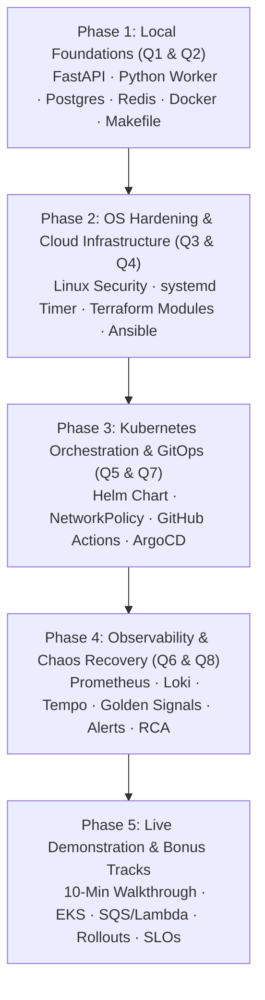

# AGENTS.md — Agent Instructions for ShopLite

`shoplite-app` is a resilient, cloud-native microservices e-commerce system built for high-throughput order processing, automated GitOps delivery, and deep distributed observability.

This document guides coding agents working on this codebase. It defines the binding engineering constraints, architectural boundaries, delivery roadmap, and verification protocols across all milestones.

---

## 1. Core Binding Constraints

These constraints override convenience. When two requirements conflict, security, data integrity, operational reliability, and architectural clarity always win.

### C1. No Guessed Code (Strict)
Every Kubernetes manifest, Helm template, Terraform resource argument, Docker instruction, FastAPI route, OpenTelemetry SDK call, and Prometheus metric MUST be verified against official documentation:
- Kubernetes & Helm: official Kubernetes (`kubernetes.io/docs/`) and Helm (`helm.sh/docs/`) specifications.
- Terraform & AWS: official HashiCorp AWS Provider (`registry.terraform.io/providers/hashicorp/aws/latest/docs`) and AWS documentation.
- OpenTelemetry & Prometheus: official OpenTelemetry Python SDK and Prometheus Client specifications.
- Never write API signatures, Prometheus metric labels, or container security configurations from memory.
- Cite the verified documentation URL or source `file:line` in task summaries, PR descriptions, and commit notes. Never include citations in production code comments.

### C2. Strict Architectural Trust Boundaries & System Separation
The system maintains an absolute separation across components, environments, and delivery pipelines:
- **Ingress & Perimeter Layer (ALB & Ingress Controller):** Inbound external traffic enters solely through the AWS Application Load Balancer across two Availability Zones, terminating public traffic and routing to the Ingress controller (`ingress-nginx`). Direct public access to internal Kubernetes pods or EC2 instances is strictly prohibited.
- **Frontend & Public API Layer:**
  - `web`: Stateless static HTML/JS served by non-root Nginx on Ingress path `/`.
  - `catalog-api`: Stateless FastAPI application on Ingress path `/api`.
- **Data & Queue Layer (PostgreSQL & Redis):** Exclusively accessible by `catalog-api` and `order-worker`. Enforced at the cluster level via Kubernetes `NetworkPolicy`. Zero external ingress permitted.
- **Background Worker Layer (`order-worker`):** Headless asynchronous consumer. Consumes from Redis, updates PostgreSQL status, and never exposes public HTTP interfaces.
- **CI/CD vs GitOps Separation (The Golden Rule):**
  - **GitHub Actions (CI):** Builds, tests, security-scans container images, publishes to Amazon ECR via AWS OIDC, and commits the updated image tag to `shoplite-gitops`.
  - **Absolute Prohibition:** The CI/CD pipeline MUST NEVER execute `kubectl apply`, `helm upgrade`, or any manual cluster deployment command.
  - **ArgoCD (GitOps):** Exclusively synchronizes and reconciles the desired state from `shoplite-gitops` to the Kubernetes cluster with automated self-healing.

### C3. No AI Attributions & Zero Third-Party Vendor References
- **No AI Attributions:** Never include mentions of AI, LLMs, Gemini, Claude, Antigravity, ChatGPT, or model names in commit messages, PR descriptions, code comments, or documentation.
- **Zero Third-Party Vendor / Platform Names:** Strictly NEVER mention third-party platforms, training organizations, assessment portals, course names, or external academic vendors in commit messages, repository metadata, documentation, comments, scripts, or environment variables. The project must strictly present as an enterprise-grade, cloud-native production system.

### C4. Deep Database, Container & Console Verification
When authoring or modifying code in any phase:
- Execute exhaustive debugging in the terminal and inspect runtime container logs.
- Perform direct database and cache inspection (`psql`, `redis-cli`) before considering any feature complete.
- Verify Docker images build cleanly with multi-stage targets, run as non-root users, and stay strictly **under 150 MB**.
- Test endpoints against HTTP status codes, verify JSON log structure on `stdout`, and ensure Prometheus metrics increment predictably.
- Confirm zero query errors, zero unhandled worker exceptions, and zero zombie processes on SIGTERM.

### C5. Security, Least Privilege & Non-Root Protocols
- **Non-Root Containers:** Every container (`web`, `catalog-api`, `order-worker`) MUST run as an unprivileged non-root user (`USER appuser`, UID `10001`). Pod security contexts must specify:
  ```yaml
  securityContext:
    runAsNonRoot: true
    runAsUser: 10001
    readOnlyRootFilesystem: true
    allowPrivilegeEscalation: false
    capabilities:
      drop: ["ALL"]
  ```
- **Linux OS Hardening:**
  - Create dedicated user `deploy` and group `ops`.
  - SSH lockdown: `PermitRootLogin no`, `PasswordAuthentication no`, key-based authentication only.
  - Directory `/var/log/shoplite/` owned by `root:ops`, permissions `750`, and exactly one POSIX default ACL rule (`setfacl -R -m g:ops:r-X`). Permission mode `777` is strictly forbidden.
  - Firewall (UFW): Default deny incoming; allow inbound ports `22`, `80`, `443` only.
- **Zero Plain-Text Secrets in Git:** Database credentials and API keys MUST be stored in Kubernetes Secrets or AWS SSM Parameter Store / Secrets Manager. Never commit secrets to Git.
- **AWS Infrastructure Least Privilege:** Kubernetes EC2 instances reside in private subnets with zero direct public IPs; administrative access is provided exclusively via AWS Systems Manager (SSM) Session Manager.

### C6. Probe, Don't Reason
An edge case, queue recovery, or observability signal is only considered verified when executed:
- Via automated unit tests (`pytest`),
- Via the end-to-end smoke test script (`scripts/smoke-test.sh`), or
- Via a live load test probe (`k6`, `hey`, or `curl` synthetic traffic).
- Always verify edge scenarios: Redis connection loss, database connection pool exhaustion, graceful shutdown under load, and pod restart backoff.

### C7. Edge Check Before Milestone Completion
Before marking any milestone or question complete, execute specific verification checks:
- **Application:** Verify automatic seeding of $\ge 10$ products on a clean database initialization.
- **Queue Resilience:** Kill the worker mid-flight and confirm `orders:processing` unhandled messages are safely recovered on startup sweep without data loss.
- **Graceful Termination:** Send `SIGTERM` to `order-worker` during an active 1–2 second order processing window and verify the order completes and logs a clean shutdown before the process exits.
- **Probes:** Confirm `/healthz` returns `200` immediately, and `/readyz` returns `503` when either PostgreSQL or Redis is unreachable.
- **Chaos Flags:** Verify all 4 chaos flags are disabled by default and activate cleanly when their environment variables are supplied.

### C8. Git & Workflow Rules
- **Two Separate Repositories:**
  1. `shoplite-app`: Application source code, Dockerfiles, Terraform modules, Ansible playbooks, Helm chart, monitoring dashboards, alert rules, runbooks, and CI workflows.
  2. `shoplite-gitops`: ArgoCD Application manifests and environment-specific Helm values (`envs/dev/values.yaml`, `envs/prod/values.yaml`).
- **Commits Only On Explicit Request:** Never run `git commit` or `git push` on your own initiative. Wait for explicit user authorization.
- **Conventional Commits:** Write clean, structured commit messages following Conventional Commits format (e.g. `feat(api): implement distributed trace propagation`, `fix(worker): handle SIGTERM during order commit`).

### C9. High-Integrity Queue & Worker Protocol
The order processing queue must adhere to the **Reliable Queue Pattern** using Redis lists:
- `catalog-api` pushes order payloads to `orders:pending` using `LPUSH`.
- `order-worker` atomically moves payloads to `orders:processing` using `BRPOPLPUSH` (or `BLMOVE`) with a timeout.
- Upon successful PostgreSQL update (`status = 'COMPLETED'`), the worker removes the payload via `LREM orders:processing 1 <payload>`.
- **Startup Recovery Sweep:** On startup, the worker inspects `orders:processing` and re-queues uncompleted orders back to `orders:pending`.
- **Termination Grace:** Kubernetes pod spec must set `terminationGracePeriodSeconds: 30` (or higher) to allow any in-flight order to complete database writes before container termination.

### C10. Structured JSON Logging Standard
Both API and worker must stream strictly valid, single-line JSON logs to `stdout`:
```json
{
  "timestamp": "2026-11-10T14:32:10.123Z",
  "level": "INFO",
  "service": "catalog-api",
  "message": "Order created successfully",
  "trace_id": "4bf92f3577b34da6a3ce929d0e0e4736",
  "order_id": 1042
}
```
- Mandatory keys: `timestamp`, `level`, `service`, `message`, `trace_id`.
- Loki uses Promtail or Grafana Alloy to parse these JSON fields automatically, enabling seamless correlation between logs and traces.

### C11. Distributed Tracing & W3C TraceContext Propagation
- **OpenTelemetry Instrumentation:** Instrument FastAPI and the asyncio worker with OpenTelemetry Python SDK.
- **Context Injection:** When an order is created in `POST /orders`, inject the active W3C `traceparent` header into the Redis JSON payload:
  ```json
  {
    "order_id": 1042,
    "traceparent": "00-4bf92f3577b34da6a3ce929d0e0e4736-00f067aa0ba902b7-01",
    "timestamp": 1700000000.123
  }
  ```
- **Context Extraction:** `order-worker` extracts `traceparent` using `TraceContextTextMapPropagator().extract(carrier)` and starts a child span `worker_process_order`.
- **End-to-End Span Hierarchy:** Trace visualization in Tempo must demonstrate the complete flow:
  `HTTP POST /orders` $\to$ `redis.lpush` $\to$ `worker_process_order` $\to$ `postgres.execute(UPDATE orders)`.
- **Loki to Tempo Linking:** Configure Grafana Loki data source with a Derived Field targeting `trace_id` regex `([a-f0-9]{32})` linked directly to the Tempo data source.

### C12. Application Metrics & Golden Signals Protocol
Expose all six mandatory Prometheus metrics on `/metrics`:

| Metric Name | Type | Labels | Description / Source |
| :--- | :--- | :--- | :--- |
| `http_requests_total` | Counter | `method`, `route`, `status` | Tracked via FastAPI middleware on all incoming requests |
| `http_request_duration_seconds` | Histogram | `method`, `route` | Request latency distribution with standard buckets |
| `orders_created_total` | Counter | *None* | Incremented upon successful `POST /orders` creation |
| `orders_processed_total` | Counter | `result` (`success` / `failed`) | Incremented by background worker on completed/failed orders |
| `order_queue_depth` | Gauge | *None* | Current size of Redis list `orders:pending` (`LLEN`) |
| `order_processing_seconds` | Histogram | *None* | Duration spent inside background worker per order |

### C13. Alerting & Runbook Contracts
All 5 required Alertmanager alerts must include explicit `severity` labels and valid `runbook_url` annotations pointing to markdown runbooks in `monitoring/runbooks/`:
1. `HighErrorRate`: HTTP 5xx rate $> 5\%$ for 5m (Critical) $\to$ `monitoring/runbooks/high-error-rate.md`
2. `HighLatency`: p95 latency $> 1.0\text{s}$ for 5m (Warning) $\to$ `monitoring/runbooks/high-latency.md`
3. `QueueBacklog`: `order_queue_depth > 50` for 10m (Warning) $\to$ `monitoring/runbooks/queue-backlog.md`
4. `PodCrashLooping`: Container restarts increasing over 10m (Critical) $\to$ `monitoring/runbooks/pod-crash-looping.md`
5. `NodeDiskFilling`: Disk space usage $> 85\%$ (Warning) $\to$ `monitoring/runbooks/node-disk-filling.md`

### C14. Chaos Engineering & Production RCA Discipline
- During the Question 8 Chaos Exercise, **DO NOT** inspect Git commit history, pull request diffs, or pod environment variables before diagnosing the issue.
- Diagnose faults strictly through the observability chain:
  1. **Alertmanager Alert Trigger** $\to$
  2. **Golden Signals Dashboard Panels** (Latency, 5xx rate, Queue Backlog, Memory) $\to$
  3. **Loki Log Inspection** (Filter by service, level=ERROR, or trace_id) $\to$
  4. **Tempo Distributed Trace** (Identify exact failing span or injected latency).
- Recover the production cluster strictly by reverting the Git commit in `shoplite-gitops` and allowing ArgoCD to self-heal the desired state.
- Document findings in a 1–2 page formal Root Cause Analysis (RCA) report at `docs/RCA/RCA_REPORT.md`.

### C15. Disciplined OOP, SOLID Principles & Clean Architecture in API Development
The Python codebase (`catalog-api` and `order-worker`) must strictly apply Object-Oriented Programming (OOP) and SOLID design principles, avoiding procedural monolithic scripts and god-functions:

1. **S — Single Responsibility Principle (SRP):**
   - **Routers (`routers/`):** Exclusively handle HTTP transport concerns: request validation, HTTP status mapping, and serialization. Routers MUST NEVER execute raw database queries or handle low-level queue protocol logic.
   - **Services (`services/`):** Encapsulate core business rules, distributed trace context injection, order state transitions, and coordination between repositories and queue providers.
   - **Repositories (`repositories/`):** Exclusively isolate data access and persistence logic (SQLAlchemy queries, entity hydration).
   - **Worker (`consumer.py` / `worker/`):** Separates the queue transport polling loop from the order processing business logic (`OrderProcessor`).
2. **O — Open/Closed Principle (OCP):**
   - Modules must be open for extension but closed for modification.
   - Queue producers and consumers must be defined using abstract interfaces (`QueueProducerInterface`, `QueueConsumerInterface` using Python `abc.ABC` or `typing.Protocol`). This allows substituting Redis with Amazon SQS (Bonus Track 2) without modifying the API's `OrderService`.
   - Chaos fault-injection strategies must be implemented as extensible hooks or middlewares rather than hardcoded if-else trees scattered through domain logic.
3. **L — Liskov Substitution Principle (LSP):**
   - Any subclass or concrete implementation (e.g. `PostgresOrderRepository` vs `InMemoryOrderRepository`, `RedisQueueService` vs `SqsQueueService`) must be fully substitutable for its abstraction without altering the correctness of calling services.
4. **I — Interface Segregation Principle (ISP):**
   - Keep interfaces narrow, cohesive, and client-specific. Do not bloat a repository interface with administrative or bulk methods that standard API workflows do not need.
   - Distinct protocols for reading (`ProductReaderProtocol`) and queueing (`QueueProducerProtocol`).
5. **D — Dependency Inversion Principle (DIP) & Dependency Injection:**
   - High-level business modules (Services) must depend upon abstractions, never upon low-level concrete drivers (`asyncpg` connections, raw `redis.Redis` instances).
   - Utilize FastAPI's built-in dependency injection container (`Depends(...)`) to inject repository, service, and cache instances into endpoint handlers.
   - Promotes rapid, isolated unit testing by allowing repositories and queues to be mocked cleanly without requiring live database connections during unit tests.
6. **Strict Typing & Mandatory Data Transfer Objects (DTOs):**
   - 100% typed Python 3.11+ using explicit type hints throughout all classes, parameters, and return types.
   - Enforce Pydantic v2 schemas as immutable Data Transfer Objects (DTOs) for request validation (`OrderCreate`, `ProductCreate`) and response contracts (`OrderOut`, `ProductOut`).
   - Absolute prohibition against passing raw, untyped dictionaries (`dict[str, Any]`) across service or repository boundaries.
7. **Pragmatic Simplicity (No Speculative Over-Engineering):**
   - Apply SOLID to achieve modularity, testability, and clarity without creating excessive boilerplate, speculative design patterns, or multi-tier factory factories. Keep domain code expressive, idiomatic, and clean.

### C16. Concise Code Documentation & Industry Code Smell Philosophy
The codebase must adhere to professional clean-code standards, proactive refactoring, and industry-standard code smell elimination (Martin Fowler / Clean Code):

1. **Self-Documenting Code & Prohibition of Verbose Comments:**
   - Code must be self-explanatory through precise domain naming, small pure functions, and unambiguous typing.
   - **Prohibition of Narrative Comments:** Paragraph-length comments, architectural essays, and redundant inline comments explaining obvious mechanics (e.g. `# save order to db`, `# commit session`, `# return 200 ok`) are strictly forbidden.
   - **Concise 1-Line Notes Only:** Limit comments and docstrings to concise 1-line notes explaining the *why* (non-obvious business logic, W3C trace header propagation mechanics, or chaos injection simulation timing), never the obvious *what*.
   - Never embed documentation links, URLs, or AI attributions inside production code comments (enforced by C1 and C3).
2. **Vigilant Elimination of Industry Code Smells:**
   - **No God Objects / Bloated Classes:** Every class must have a single, coherent responsibility. Never combine queue transport, DB queries, and HTTP routing into one file or class.
   - **No Long Methods:** Keep functions and methods focused and short ($\le 25\text{ lines}$). Procedural chunks must be extracted into private helper methods with intention-revealing names.
   - **No Primitive Obsession:** Avoid passing raw primitives or arbitrary dictionaries across layers; encapsulate domain concepts in typed Pydantic models, Python Enums (e.g. `OrderStatus.PENDING`, `OrderStatus.COMPLETED`), and Value Objects.
   - **No Magic Numbers & String Literals:** Extract all hardcoded magic numbers (timeouts, sleep durations, thresholds) and string literals (queue keys `orders:pending`, `orders:processing`, status values) into centralized configuration or domain constants.
   - **No Duplicate Logic (DRY):** Never duplicate query filters, payload serialization logic, or error response formats. Co-locate operations with data in services or repositories.
   - **No Feature Envy / Inappropriate Intimacy:** Ensure methods belong to the class that owns the relevant data; do not query an external object's internal structure repeatedly when an encapsulated method belongs on that object.
   - **No Dead Code & Speculative Generality:** Strictly eliminate commented-out code blocks, unused imports, zombie variables, or generic wrappers built for hypothetical future needs. Follow YAGNI (You Aren't Gonna Need It) and KISS (Keep It Simple, Stupid).

### C17. Pragmatic Simplicity: No Over-Engineering, No Speculative Abstractions & Developer-First Maintainability
The codebase must remain lean, approachable, and effortless to maintain:

1. **Strict Prohibition of Over-Engineering & Speculative Wrappers (YAGNI & KISS):**
   - Never build generic "frameworks within frameworks", multi-tier abstract factories, reflection magic, or complex meta-programming when a direct, readable implementation satisfies the task.
   - **No Redundant Pass-Through Layers:** Never create vacuous interfaces, empty wrapper classes, or boilerplate delegates that merely forward calls to an underlying library without adding domain value.
   - Build strictly for the stated Capstone requirements. Speculative generality for hypothetical future needs is strictly forbidden.
2. **Developer-First & High Maintainability by Design:**
   - Code must be immediately comprehensible to any engineer without requiring mental gymnastics or tracing through 10 layers of abstraction.
   - Maintain small, cohesive modules ($\le 200\text{ lines}$ per file where possible). Co-locate related logic logically so developers can trace an entire endpoint flow from route to service to repository without disorientation.
   - Prefer straightforward, idiomatic Python and standard library features over obscure language features or third-party bloat.
3. **Low Cognitive Load & Easy Testability:**
   - Design classes and functions so that writing a unit test requires minimal fixture ceremony.
   - Keep dependency graphs flat and shallow, preventing circular dependencies and deeply nested injection trees.

### C18. Testing Philosophy: Contract-First TDD & Probe-Driven Infrastructure Verification
Testing follows a disciplined 3-tier strategy combining Test-Driven Development (TDD) for business rules and API contracts with probe-driven automated verification for infrastructure and containers:

1. **Tier 1 — Contract-First TDD for `catalog-api` (Red $\to$ Green $\to$ Refactor):**
   - **TDD First:** API contract unit tests (`services/catalog-api/tests/test_api.py`) MUST be written *before* implementing route handlers, database persistence, and queue integration.
   - **Locked Contract Verification:** Unit tests must validate the exact requirements of Question 1.2 and Question 1.5:
     - `GET /products` returns `200 OK` and product collection.
     - `GET /products/{id}` returns `200 OK` for existing items, `404 Not Found` for non-existent IDs.
     - `POST /orders` validates `{"product_id": int, "quantity": int}`, returns `201 Created` with `order_id` and status `PENDING`.
     - `GET /orders/{id}` returns current status (`PENDING`, `PROCESSING`, `COMPLETED`, `FAILED`).
     - `GET /healthz` returns `200 OK` liveness status.
     - `GET /readyz` returns `200 OK` when dependencies connect, `503 Service Unavailable` when database or Redis is down.
     - `GET /metrics` exports Prometheus exposition text.
     - Fault-injection flags: verify `CHAOS_ERROR_RATE` triggers `500` and `CHAOS_LATENCY_MS` injects delay.
   - **Isolated & Fast Execution:** Use FastAPI dependency injection overrides (`app.dependency_overrides`) to mock database sessions and Redis queues during unit tests. The unit test suite must execute in $< 2\text{ seconds}$ without requiring external live infrastructure.
   - **Requirement Check:** Minimum $\ge 5$ unit tests are compulsory for Question 1.4(d).

2. **Tier 2 — Scenario-Driven TDD for `order-worker`:**
   - Write scenario tests verifying state transitions: `PENDING` $\to$ `PROCESSING` $\to$ `COMPLETED`.
   - Test queue resilience: assert that startup sweep atomically moves unhandled payloads from `orders:processing` back to `orders:pending`.
   - Test graceful shutdown: verify that `SIGTERM` allows in-flight order writes to commit before the process exits cleanly.

3. **Tier 3 — Probe-Driven Smoke Testing for Docker & Infrastructure (Q2 Checkpoint):**
   - Containerization and infrastructure cannot be verified purely through in-memory unit tests; they must be verified through automated live probes.
   - `scripts/smoke-test.sh` executes end-to-end against the running stack:
     1. Probes `/readyz` until database and Redis report healthy.
     2. Verifies $\ge 10$ seeded products exist in PostgreSQL.
     3. Places a live test order (`POST /orders`).
     4. Polls the order until its status reaches `COMPLETED`.
     5. Exits with non-zero code on any failure.
   - **Milestone 1 Gate:** The command `make up && make smoke` MUST pass cleanly on a clean machine before considering Question 1 and Question 2 complete.

---

## 2. Environment & Commands Reference

### Local Development & Verification (Docker Compose)
```bash
# Build, start, and tear down full local stack
make build                           # Build multi-stage images (<150MB, non-root)
make up                              # Start web, catalog-api, order-worker, postgres, redis
make down                            # Tear down containers and named volumes
make test                            # Run API unit test suite (>= 5 unit tests)
make smoke                           # Run end-to-end smoke test script

# Clean machine checkpoint verification
make up && make smoke
```

### Direct Inspection & Diagnostics
```bash
# Check service health and readiness
curl -s http://localhost:8000/healthz
curl -s http://localhost:8000/readyz
curl -s http://localhost:8000/metrics

# PostgreSQL CLI inspection
docker compose exec postgres psql -U shoplite -d shoplite_db -c "SELECT * FROM products;"
docker compose exec postgres psql -U shoplite -d shoplite_db -c "SELECT * FROM orders ORDER BY id DESC LIMIT 10;"

# Redis CLI queue inspection
docker compose exec redis redis-cli LLEN orders:pending
docker compose exec redis redis-cli LLEN orders:processing
docker compose exec redis redis-cli LRANGE orders:pending 0 -1
```

### Linux Server Hardening Verification (Q3)
```bash
# Verify SSH settings
sshd -T | grep -E "(permitrootlogin|passwordauthentication|pubkeyauthentication)"

# Verify ACLs on log directory
ls -ld /var/log/shoplite
getfacl /var/log/shoplite

# Verify systemd backup timer & service
systemctl status shoplite-backup.timer
systemctl list-timers --all | grep shoplite-backup
systemctl status shoplite-backup.service

# Verify firewall and open ports
sudo ufw status verbose
ss -tulpn
```

### Terraform & AWS Infrastructure (Q4)
```bash
cd terraform
terraform init                       # Initializes remote S3 state and DynamoDB locks
terraform validate                   # Validate HCL syntax
terraform plan                       # Generate execution plan
terraform apply                      # Provision VPC, ALB, ECR, and Compute
terraform destroy                    # Teardown after grading (Cost Guard)
```

### Kubernetes & Helm (Q5 & Q6)
```bash
# Helm packaging and deployment
helm lint helm/shoplite
helm upgrade --install shoplite helm/shoplite -n shoplite --create-namespace -f helm/shoplite/values-dev.yaml

# Inspect Kubernetes workloads
kubectl get pods,svc,ingress,pdb,hpa -n shoplite
kubectl describe networkpolicy shoplite-network-policy -n shoplite

# Verify ArgoCD self-healing
kubectl scale deployment catalog-api -n shoplite --replicas=0
kubectl get pods -n shoplite -w      # Watch ArgoCD automatically restore 2 replicas
```

---

## 3. Step-by-Step Delivery Roadmap

Development follows a structured 5-phase progression matching the assessment milestones:



### Phase 1: Local Application Foundations & Containerization (Q1 & Q2)
- **Scaffold Repositories:** Set up `shoplite-app` and `shoplite-gitops`.
- **Implement `catalog-api` (FastAPI):**
  - Implement all 7 endpoints (`/products`, `/products/{id}`, `/orders`, `/orders/{id}`, `/healthz`, `/readyz`, `/metrics`).
  - Wire database models (`Product`, `Order`) and automatic seeding ($\ge 10$ products).
  - Implement fault-injection flags: `CHAOS_LATENCY_MS` and `CHAOS_ERROR_RATE`.
  - Structured JSON logging to `stdout` with `trace_id`.
  - Write at least 5 unit tests (`services/catalog-api/tests/test_api.py`).
- **Implement `order-worker`:**
  - Reliable queue loop with `BRPOPLPUSH` from `orders:pending` to `orders:processing`.
  - Process simulated delay (1–2s), update PostgreSQL status to `COMPLETED`, clean up queue.
  - Wire fault-injection flags: `CHAOS_SLOW_DB` and `CHAOS_MEMORY_LEAK`.
  - Implement graceful shutdown handler for `SIGTERM` and `SIGINT`.
- **Implement `web`:**
  - Responsive HTML5/Tailwind/Vanilla JS frontend served by Nginx Alpine.
  - Product catalog listing, "Order Now" action, and real-time polling widget.
- **Docker & Compose:**
  - Multi-stage Dockerfiles for all 3 components with non-root user `appuser` (UID `10001`), `.dockerignore`, and inline `HEALTHCHECK`.
  - Verify all final image sizes stay under **150 MB**.
  - Configure `docker-compose.yml` with health dependencies and named volume `postgres_data`.
  - Create `scripts/smoke-test.sh` and `Makefile`. Verify `make up && make smoke` passes cleanly.

### Phase 2: Linux Administration & AWS Infrastructure as Code (Q3 & Q4)
- **Linux Hardening (Q3):**
  - Provision deploy user and ops group; lock down `/etc/ssh/sshd_config` to key-only.
  - Configure permissions and ACLs on `/var/log/shoplite/`.
  - Implement `shoplite-backup.service` and `shoplite-backup.timer` for nightly `pg_dump` backups.
  - Configure UFW firewall (allow 22, 80, 443; deny all incoming by default).
  - Capture required terminal screenshots under `linux/evidence/`.
- **Terraform Infrastructure as Code (Q4):**
  - Configure remote S3 backend with DynamoDB state locking.
  - Structure reusable modules: `network`, `compute`, `alb`, `ecr`.
  - Deploy custom VPC across 2 AZs (2 public, 2 private subnets, IGW, NAT Gateway).
  - Launch 1 control plane EC2 and 2 worker EC2 instances in private subnets with IAM roles for SSM.
  - Create public Application Load Balancer forwarding to ingress NodePorts.
  - Create Amazon ECR repositories for `shoplite-web`, `shoplite-catalog-api`, and `shoplite-order-worker`.
  - Configure AWS Budget alarm at $20 and tag all resources `project=shoplite`.
- **Ansible Configuration:**
  - Playbooks to harden OS, install `containerd`, bootstrap Kubernetes (`kubeadm`), join workers, and retrieve `kubeconfig`.

### Phase 3: Kubernetes Orchestration & GitOps Automation (Q5 & Q7)
- **Helm Packaging (Q5):**
  - Package ShopLite workloads into a single unified Helm chart (`helm/shoplite/`).
  - Deploy into `shoplite` namespace with `values-dev.yaml` and `values-prod.yaml`.
  - Configure resource requests/limits, PodDisruptionBudget (`minAvailable: 1`), and HPA for worker (1–4 replicas).
  - Implement PostgreSQL StatefulSet with PVC and automatic initialization seed.
  - Implement Kubernetes Secret for DB credentials and ConfigMap for non-sensitive settings.
  - Define `NetworkPolicy` isolating PostgreSQL and Redis to API and worker pods only.
- **GitHub Actions CI Pipeline (Q7):**
  - Main branch workflow: lint (`hadolint`, `helm lint`, Python linter), run unit tests, build images tagged with short Git SHA, scan with Trivy (fail on CRITICAL CVEs), push to ECR via AWS OIDC, and commit updated image tag to `shoplite-gitops`.
  - Pull request workflow: lint, test, build, scan, and post `terraform plan` output as PR comment.
- **ArgoCD GitOps Automation:**
  - Configure `shoplite-dev` (auto-sync, prune, selfHeal) and `shoplite-prod` (manual sync).
  - Demonstrate self-healing: scale deployment to 0 replicas with `kubectl` and verify ArgoCD restores state.

### Phase 4: Full Observability Stack & Chaos Recovery (Q6 & Q8)
- **Deploy Observability Stack (Q6):**
  - Deploy `kube-prometheus-stack`, Loki, Promtail/Alloy, and Tempo into `monitoring` namespace.
  - Configure Prometheus `ServiceMonitor` to scrape application `/metrics`.
  - Configure OpenTelemetry OTLP trace exporter to Tempo (`http://tempo.monitoring:4317`).
  - Configure Loki JSON parsing and derived field link for `trace_id` pointing to Tempo.
- **Provision Golden Signals Dashboard:**
  - Commit JSON dashboard to `monitoring/dashboards/`: RPS, p50/p95/p99 latency, 5xx error rate, pod CPU/memory, queue depth, worker replicas, and orders created vs. processed.
- **Configure Alerts & Runbooks:**
  - Configure 5 alert rules in `monitoring/alert-rules/alerts.yaml` with severity and `runbook_url`.
  - Create corresponding runbook markdown files in `monitoring/runbooks/`.
- **Chaos Exercise & Root Cause Analysis (Q8):**
  - Peer enables one chaos flag in `shoplite-gitops` production values.
  - Execute 15-minute load test at $\ge 20\text{ RPS}$ (`k6 run loadtest.js`).
  - Trace issue solely using Grafana Golden Signals $\to$ Loki error logs $\to$ Tempo distributed traces.
  - Revert commit in GitOps repo and watch ArgoCD restore cluster health.
  - Author formal 1–2 page RCA report at `docs/RCA/RCA_REPORT.md`.

### Phase 5: Live Demonstration Readiness & Bonus Tracks
- Rehearse 10-minute live demonstration checklist (Architecture $\to$ Git Push to Browser $\to$ Golden Signals under load $\to$ Tempo trace-to-log navigation $\to$ ArgoCD self-healing).
- Complete Bonus Tracks (+10 Marks):
  - **Bonus 1 (+3):** Managed Amazon EKS module with IRSA / Pod Identity.
  - **Bonus 2 (+3):** SQS queue replacement and AWS Lambda confirmation trigger.
  - **Bonus 3 (+2):** Canary deployment using Argo Rollouts and Prometheus analysis.
  - **Bonus 4 (+2):** Multi-window multi-burn-rate Google SRE alerts for `POST /orders`.

---

## 4. Key Architectural Definitions & Standards

| Concept | Implementation Standard |
| :--- | :--- |
| **API Framework** | Python 3.11/3.12 with FastAPI & Uvicorn |
| **Code Architecture & Design** | Strict OOP & SOLID (Routers $\to$ Services $\to$ Repositories), Dependency Injection via FastAPI `Depends()`, Pydantic v2 DTOs |
| **Clean Code & Smell Prevention** | Self-documenting code, short methods ($\le 25$ lines), Enums/Constants (no magic values), zero narrative comments |
| **Pragmatic Simplicity** | No over-engineering, zero speculative wrappers/factories (YAGNI/KISS), flat dependency graphs, developer-friendly |
| **Testing Strategy** | 3-Tier: Contract-First TDD (API), Scenario-Driven TDD (Worker), Probe-Driven Smoke Testing (`make smoke`) |
| **Worker Engine** | Python Asyncio loop with signal handlers (`SIGTERM`, `SIGINT`) |
| **Queue Pattern** | Reliable Redis List (`LPUSH` $\to$ `BRPOPLPUSH` $\to$ `LREM`) with startup orphan recovery sweep |
| **Database Migrations** | Automatic table creation (`products`, `orders`) and $\ge 10$ product seed on startup |
| **Container Images** | Multi-stage Dockerfiles, non-root user `appuser` (UID `10001`), `.dockerignore`, strictly $<150\text{ MB}$ |
| **Linux SSH Hardening** | `PermitRootLogin no`, `PasswordAuthentication no`, key-only authentication |
| **Directory Permissions** | `/var/log/shoplite/` owned by `root:ops`, permissions `750`, POSIX default ACL `g:ops:r-X` |
| **Backup Automation** | `shoplite-backup.service` and `shoplite-backup.timer` running nightly `pg_dump` |
| **AWS Network** | 2 Availability Zones, 2 Public Subnets (ALB, NAT), 2 Private Subnets (K8s Nodes) |
| **Remote State** | S3 bucket with server-side encryption + DynamoDB state locking table |
| **Kubernetes Namespace** | Application deployed exclusively in namespace `shoplite` |
| **Pod Security** | Non-root UID `10001`, `readOnlyRootFilesystem: true`, capabilities dropped |
| **Network Isolation** | `NetworkPolicy` restricting PostgreSQL (5432) and Redis (6379) to API and worker only |
| **CI/CD Trust** | GitHub Actions authenticates via AWS OIDC; zero `kubectl apply` in CI |
| **GitOps Engine** | ArgoCD with automated sync on Dev and manual promotion on Prod, self-healing enabled |
| **Distributed Tracing** | OpenTelemetry SDK exporting OTLP to Tempo; W3C `traceparent` passed through Redis |
| **Log-Trace Correlation** | Loki derived field linking `trace_id` regex `([a-f0-9]{32})` directly to Tempo trace view |
| **Chaos Flags** | `CHAOS_LATENCY_MS`, `CHAOS_ERROR_RATE`, `CHAOS_MEMORY_LEAK`, `CHAOS_SLOW_DB` (disabled by default) |
| **Root Cause Analysis** | 1–2 page formal report (`docs/RCA/RCA_REPORT.md`) based strictly on observability evidence |
