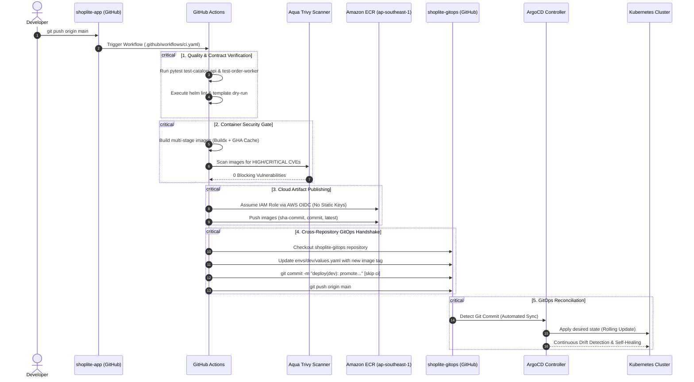

# ShopLite — Resilient Cloud-Native Microservices Platform

[](https://fastapi.tiangolo.com)
[](https://www.python.org/)
[](https://www.postgresql.org/)
[](https://redis.io/)
[](https://www.docker.com/)
[](https://kubernetes.io/)
[](https://helm.sh/)
[](https://www.terraform.io/)
[](https://prometheus.io/)
[](https://grafana.com/)
[](https://argoproj.github.io/cd/)

**ShopLite** is an enterprise-grade, cloud-native microservices e-commerce system engineered for high-throughput order processing, automated GitOps delivery, resilient queue self-healing, and end-to-end distributed observability.

---

## 1. System Architecture & Topology

```
                                  Internet
                                     │
                            ┌────────▼────────┐
                            │   Public ALB    │ (AWS Application Load Balancer - 2 AZs)
                            └────────┬────────┘
                                     │ HTTP / HTTPS
                            ┌────────▼────────────────────────────────────────┐
                            │ Ingress Controller (ingress-nginx)              │
                            └────────┬───────────────────────────────┬────────┘
                                     │ path: /                       │ path: /api
                         ┌───────────▼───────────┐       ┌───────────▼───────────┐
                         │  web (Nginx Alpine)   │       │  catalog-api (FastAPI)│
                         │  (Stateless Frontend) │       │  (OpenTelemetry SDK)  │
                         └───────────────────────┘       └─────┬───────────┬─────┘
                                                               │           │
                                       ┌───────────────────────┘           └───────────────────────┐
                                       │                                                           │
                              SQL      │                                        RPUSH              │
                         ┌─────────────▼─────────────┐                             ┌───────────────▼──────────────┐
                         │ postgres (PostgreSQL 16)  │                             │ redis (Redis 7.2 Alpine)     │
                         │ StatefulSet + PVC (Seed)  │                             │ List: orders:pending         │
                         └─────────────▲─────────────┘                             └───────────────▲──────────────┘
                                       │                                                           │
                                       │ SQL UPDATE (Status)                 BRPOPLPUSH / LREM     │
                                       └───────────────────────┌───────────────────────────────────┘
                                                               │
                                                 ┌─────────────┴─────────────┐
                                                 │ order-worker (Python Async│
                                                 │ + OpenTelemetry Context)  │
                                                 └───────────────────────────┘
```

### Core Architecture Highlights
- **Decoupled Asynchronous Processing:** The API offloads order fulfillment to background workers via atomic Redis queue lists, insulating customer requests from processing spikes.
- **Reliable Queue Pattern:** Prevents lost messages during worker crashes using atomic `BRPOPLPUSH` / `BLMOVE` from `orders:pending` to `orders:processing`, coupled with startup crash recovery sweeps.
- **Clean Architecture & SOLID Principles:** Strict layer separation: Routers (HTTP transport) $\to$ Services (business rules) $\to$ Repositories (database persistence) with Pydantic v2 immutable DTOs and dependency injection.
- **W3C Distributed Tracing:** Propagates `traceparent` headers through Redis message payloads, creating an unbroken trace span hierarchy in Grafana Tempo (`API` $\to$ `Redis` $\to$ `Worker` $\to$ `PostgreSQL`).
- **GitOps Delivery Model:** Strict separation between GitHub Actions CI (builds, unit tests, Trivy CVE scans, ECR push) and ArgoCD (declarative Kubernetes reconciliation and automated self-healing).

---

## 2. Component Specifications

| Component | Responsibility | Tech Stack | Container Details | Internal Ports |
| :--- | :--- | :--- | :--- | :--- |
| **`web`** | Stateless presentation layer; lists products, places orders, polls status | Nginx Alpine, HTML5, Vanilla JS | Multi-stage, non-root (`UID 10001`), $< 50\text{ MB}$ | `80` |
| **`catalog-api`** | REST API; validates contracts, executes queries, enqueues order events | Python 3.11+, FastAPI, Uvicorn, SQLAlchemy (Async) | Multi-stage, non-root (`UID 10001`), $< 150\text{ MB}$ | `8000` |
| **`order-worker`** | Headless queue consumer; processes orders (1–2s delay), updates state | Python 3.11+, Asyncio, Redis-py, OpenTelemetry | Multi-stage, non-root (`UID 10001`), $< 150\text{ MB}$ | — |
| **`postgres`** | Relational persistence; auto-seeds catalog products, tracks orders | PostgreSQL 16 Alpine | Persistent Volume Claim / Named Volume | `5432` |
| **`redis`** | In-memory message broker; provides reliable double-buffered list queue | Redis 7.2 Alpine | ClusterIP Service only; protected by NetworkPolicy | `6379` |

---

## 3. API Contract & Endpoints

| Method | Endpoint | Description | Expected Status Codes |
| :--- | :--- | :--- | :--- |
| **`GET`** | `/products` | Retrieve all available products in catalog | `200 OK` |
| **`GET`** | `/products/{id}` | Retrieve single product details (supports chaos latency) | `200 OK`, `404 Not Found` |
| **`POST`** | `/orders` | Submit new order payload `{"product_id": 1, "quantity": 2}` | `201 Created` (`order_id`, `status: PENDING`), `404 Not Found`, `500 Internal Server Error` (chaos) |
| **`GET`** | `/orders/{id}` | Check status: `PENDING`, `PROCESSING`, `COMPLETED`, `FAILED` | `200 OK`, `404 Not Found` |
| **`GET`** | `/healthz` | Kubernetes liveness probe (process up check) | `200 OK` |
| **`GET`** | `/readyz` | Kubernetes readiness probe (verifies DB & Redis connections) | `200 OK`, `503 Service Unavailable` |
| **`GET`** | `/metrics` | Prometheus metrics exposition (all 6 golden metrics) | `200 OK` |

---

## 4. Observability & Golden Signals

### 4.1 Exported Application Metrics (`/metrics`)

| Metric Name | Type | Labels | Description |
| :--- | :--- | :--- | :--- |
| `http_requests_total` | Counter | `method`, `route`, `status` | Rate and volume of incoming HTTP traffic |
| `http_request_duration_seconds` | Histogram | `method`, `route` | Request latency distribution across all routes |
| `orders_created_total` | Counter | *None* | Count of valid orders accepted by API |
| `orders_processed_total` | Counter | `result` (`success` / `failed`) | Count of orders fulfilled by background worker |
| `order_queue_depth` | Gauge | *None* | Current size of Redis pending list (`orders:pending`) |
| `order_processing_seconds` | Histogram | *None* | Time taken by worker to process an individual order |

### 4.2 Logging Standard
Both `catalog-api` and `order-worker` output single-line structured JSON logs directly to `stdout`:
```json
{
  "timestamp": "2026-11-10T14:32:10.123Z",
  "level": "INFO",
  "service": "catalog-api",
  "message": "Order created successfully",
  "trace_id": "4bf92f3577b34da6a3ce929d0e0e4736",
  "order_id": 1042
}
```

### 4.3 Production Alertmanager Rules
1. `HighErrorRate` (Critical): HTTP 5xx error rate $> 5\%$ for 5 minutes.
2. `HighLatency` (Warning): p95 latency $> 1.0\text{s}$ for 5 minutes.
3. `QueueBacklog` (Warning): `order_queue_depth > 50` for 10 minutes.
4. `PodCrashLooping` (Critical): Container restarts increasing over a 10-minute window.
5. `NodeDiskFilling` (Warning): Host disk space utilization exceeds $85\%$.

---

## 5. Fault-Injection & Chaos Engineering

All fault-injection flags are **disabled by default** and activated exclusively during reliability verification exercises:

| Environment Variable | Target Service | Injected Behavior |
| :--- | :--- | :--- |
| `CHAOS_LATENCY_MS` | `catalog-api` | Injects configured delay (ms) into $\approx 30\%$ of `GET /products/{id}` requests |
| `CHAOS_ERROR_RATE` | `catalog-api` | Returns `HTTP 500` for specified fraction (e.g. `0.2` = 20%) of `POST /orders` |
| `CHAOS_MEMORY_LEAK` | `order-worker` | Retains an accumulating 1MB byte buffer per processed order, leading to OOMKilled |
| `CHAOS_SLOW_DB` | `order-worker` | Executes `SELECT pg_sleep(2)` before database updates, causing queue depth backlog |

---

## 6. Repository Layout (GitOps Split)

The system operates across two isolated repositories:

### Repository 1: `shoplite-app` (This Repository)
```
shoplite-app/
├── services/
│   ├── web/                    # Static frontend (Nginx + JS)
│   ├── catalog-api/            # FastAPI REST API
│   │   ├── app/                # Routers, Services, Repositories, Schemas
│   │   └── tests/              # Contract-First Unit Tests
│   └── order-worker/           # Asyncio Queue Consumer & Processor
├── docker-compose.yml          # Local multi-service development stack
├── Makefile                    # Developer workflow automation
├── scripts/
│   └── smoke-test.sh           # End-to-end runtime probe validation
├── linux/                      # Server hardening configs, systemd backup, UFW
├── terraform/                  # Modular IaC (network, compute, alb, ecr)
├── ansible/                    # Cluster configuration & runtime bootstrap
├── helm/
│   └── shoplite/               # Production Helm chart (dev & prod values)
├── monitoring/
│   ├── dashboards/             # Golden Signals Grafana dashboards as code
│   ├── alert-rules/            # Prometheus alert rules
│   └── runbooks/               # Incident remediation runbooks
└── .github/
    └── workflows/              # GitHub Actions CI pipelines (OIDC + Trivy)
```

### Repository 2: `shoplite-gitops`
```
shoplite-gitops/
├── apps/
│   ├── shoplite-dev.yaml       # ArgoCD Application (Automated Sync + Self-Heal)
│   └── shoplite-prod.yaml      # ArgoCD Application (Manual Sync Gate)
└── envs/
    ├── dev/values.yaml         # Environment-specific Helm values
    └── prod/values.yaml        # Production Helm values
```

---

## 7. Automated CI/CD & GitOps Delivery Pipeline

The ShopLite delivery lifecycle enforces **The Golden Rule (Constraint C2)**: complete physical and architectural separation between Continuous Integration (CI) in `shoplite-app` and Continuous Delivery / GitOps (CD) in `shoplite-gitops`.

### 7.1 Delivery Architecture & Handshake Sequence



### 7.2 Workflow Triggers & Execution Modes

The workflow in [.github/workflows/ci.yaml](file:///.github/workflows/ci.yaml) supports three execution modes:
1. **Push to `main`:** Runs full pipeline (Test $\to$ Scan $\to$ Publish $\to$ GitOps Promote).
2. **Pull Request to `main`:** Runs validation gates only (Test $\to$ Scan). Publishing and GitOps promotion steps are skipped.
3. **Manual Trigger (`workflow_dispatch`):** Allows triggering full pipeline runs from the GitHub UI Actions tab or via GitHub CLI:
   ```bash
   gh workflow run ci.yaml --ref main
   ```

### 7.3 Security Posture & Least Privilege
- **Zero Static AWS Keys:** Uses GitHub Actions OpenID Connect (OIDC) identity provider with AWS IAM role assumption (`sts:AssumeRoleWithWebIdentity`).
- **Zero Cluster-Admin CI Tokens:** CI runners possess zero Kubernetes credentials and execute zero `kubectl` or `helm upgrade` commands. All deployments are reconciled exclusively by ArgoCD from `shoplite-gitops`.
- **Shift-Left Vulnerability Gate:** Multi-stage builds are scanned with Aqua Security Trivy, blocking deployment on any unpatched `CRITICAL` or `HIGH` vulnerabilities.

---

## 8. Quick Start & Local Development

### Prerequisites
- Docker Engine 24+ and Docker Compose v2
- `make` utility
- `curl` and `jq`

### One-Command Checkpoint
```bash
# Build multi-stage images, start stack, and execute end-to-end smoke test
make up && make smoke
```

### Step-by-Step Commands

```bash
# 1. Build all container images (<150MB, non-root)
make build

# 2. Start full local environment in background
make up

# 3. Inspect running services and health status
docker compose ps

# 4. Run API unit tests (Contract-First TDD suite)
make test

# 5. Run end-to-end automated smoke test
make smoke

# 6. Tear down stack and prune named volumes
make down
```

---

## 9. Direct Inspection & Diagnostics

```bash
# Check service liveness and readiness
curl -s http://localhost:8000/healthz
curl -s http://localhost:8000/readyz

# Inspect Prometheus exposition metrics
curl -s http://localhost:8000/metrics | grep -E "(http_requests|orders_|order_queue)"

# Database inspection (Verify >= 10 seeded products)
docker compose exec postgres psql -U shoplite_user -d shoplite_db -c "SELECT id, name, price, stock FROM products;"
docker compose exec postgres psql -U shoplite_user -d shoplite_db -c "SELECT id, product_id, quantity, status, completed_at FROM orders ORDER BY id DESC LIMIT 5;"

# Redis queue inspection
docker compose exec redis redis-cli LLEN orders:pending
docker compose exec redis redis-cli LLEN orders:processing
```

---

## 10. Testing Strategy (3-Tier Testing Protocol)

Testing adheres to **Constraint C18** in [AGENTS.md](file:///E:/shoplite-app/AGENTS.md):

1. **Tier 1 — Contract-First TDD (`catalog-api`):**
   - Unit tests (`services/catalog-api/tests/test_api.py`) are authored **before** route implementations.
   - Mocked dependencies run via FastAPI's `app.dependency_overrides` executing in $<2\text{ seconds}$ without external services.
2. **Tier 2 — Scenario-Driven TDD (`order-worker`):**
   - Validates state transitions (`PENDING` $\to$ `PROCESSING` $\to$ `COMPLETED`).
   - Validates startup recovery of orphaned messages from `orders:processing`.
   - Validates graceful shutdown and order write completion upon `SIGTERM`.
3. **Tier 3 — Probe-Driven Smoke Testing (`scripts/smoke-test.sh`):**
   - Automated runtime script that polls `/readyz`, validates database seeding, places a real order, and polls until `COMPLETED`.

---

## 11. Engineering Standards & Agent Instructions

This repository is governed by [AGENTS.md](file:///E:/shoplite-app/AGENTS.md), defining binding rules across all development phases:
- **No Guessed Code (C1):** Official documentation verification required for all IaC, Kubernetes, and API APIs.
- **Strict Non-Root Security (C5):** Containers run as `UID 10001` with read-only root filesystems and dropped capabilities.
- **SOLID Architecture (C15):** Separation of Routers, Services, and Repositories with Pydantic v2 DTOs.
- **Clean Code & Smell Elimination (C16):** Concise 1-line notes only; zero narrative comments; short methods ($\le 25$ lines).
- **Pragmatic Simplicity (C17):** Strict enforcement of YAGNI and KISS; zero speculative abstraction or framework wrappers.
- **Zero Third-Party Vendor References (C3):** The project presents strictly as an enterprise production system.
