# API Low-Level Design (LLD) & Component Architecture

This document specifies the Object-Oriented Programming (OOP) model, SOLID principles application, clean layered architecture, and component interactions across `catalog-api` and `order-worker`.

---

## 1. Class & Layered Architecture Diagram

```mermaid
classDiagram
    %% Presentation / HTTP Transport Layer
    class ProductRouter {
        +list_products(db: AsyncSession) list~ProductOut~
        +get_product(id: int, db: AsyncSession) ProductOut
    }

    class OrderRouter {
        +create_order(payload: OrderCreate, db: AsyncSession) dict
        +get_order(id: int, db: AsyncSession) OrderOut
    }

    class HealthRouter {
        +healthz() dict
        +readyz(response: Response) dict
        +metrics() Response
    }

    %% Service / Business Logic Layer (SRP & DIP)
    class ProductService {
        -product_repo: ProductRepositoryProtocol
        +get_all_products() list~ProductOut~
        +get_by_id(id: int) ProductOut
        -simulate_chaos_latency() void
    }

    class OrderService {
        -order_repo: OrderRepositoryProtocol
        -queue_producer: QueueProducerProtocol
        +create_order(payload: OrderCreate) OrderOut
        +get_order_status(order_id: int) OrderOut
        -inject_trace_context(payload: dict) dict
    }

    %% Queue Abstraction (OCP & LSP)
    class QueueProducerProtocol {
        <<interface>>
        +publish_order(payload: QueuePayloadDTO) bool
        +get_queue_depth() int
    }

    class RedisQueueProducer {
        -redis_client: Redis
        +publish_order(payload: QueuePayloadDTO) bool
        +get_queue_depth() int
    }

    class SqsQueueProducer {
        -sqs_client: boto3
        +publish_order(payload: QueuePayloadDTO) bool
        +get_queue_depth() int
    }

    %% Data Access / Repository Layer (SRP)
    class ProductRepositoryProtocol {
        <<interface>>
        +find_all() list~Product~
        +find_by_id(id: int) Product
    }

    class PostgresProductRepository {
        -session: AsyncSession
        +find_all() list~Product~
        +find_by_id(id: int) Product
    }

    class OrderRepositoryProtocol {
        <<interface>>
        +create(order: Order) Order
        +find_by_id(id: int) Order
        +update_status(id: int, status: str) bool
    }

    class PostgresOrderRepository {
        -session: AsyncSession
        +create(order: Order) Order
        +find_by_id(id: int) Order
        +update_status(id: int, status: str) bool
    }

    %% Worker Components (Separation of Consumer and Processor)
    class ReliableOrderConsumer {
        -redis: Redis
        -is_running: bool
        +run() void
        +recover_orphaned_orders() void
        +stop(signal, frame) void
    }

    class OrderProcessor {
        -order_repo: OrderRepositoryProtocol
        +process(raw_payload: str) bool
        -simulate_work() void
        -handle_chaos_flags() void
    }

    %% Data Transfer Objects (Pydantic v2 Immutable Contracts)
    class ProductOut {
        +int id
        +str name
        +float price
        +int stock
    }

    class OrderCreate {
        +int product_id
        +int quantity
    }

    class OrderOut {
        +int id
        +int product_id
        +int quantity
        +str status
        +datetime created_at
        +datetime completed_at
    }

    class QueuePayloadDTO {
        +int order_id
        +str traceparent
        +float timestamp
    }

    %% Relationships
    ProductRouter --> ProductService : delegates via Depends()
    OrderRouter --> OrderService : delegates via Depends()
    ProductService --> ProductRepositoryProtocol : depends on abstraction
    OrderService --> OrderRepositoryProtocol : depends on abstraction
    OrderService --> QueueProducerProtocol : depends on abstraction
    PostgresProductRepository ..|> ProductRepositoryProtocol : implements
    PostgresOrderRepository ..|> OrderRepositoryProtocol : implements
    RedisQueueProducer ..|> QueueProducerProtocol : implements
    SqsQueueProducer ..|> QueueProducerProtocol : implements (Bonus 2)
    OrderRouter ..> OrderCreate : validates request
    OrderRouter ..> OrderOut : returns response
    ProductRouter ..> ProductOut : returns response
    OrderService ..> QueuePayloadDTO : builds message
    ReliableOrderConsumer --> OrderProcessor : delegates order work
```



---

## 2. SOLID Principles Application Matrix

| Principle | Architectural Implementation in ShopLite |
| :--- | :--- |
| **S — Single Responsibility (SRP)** | **Routers** exclusively handle HTTP parameters and response status codes. **Services** contain business validation, W3C trace context injection, and domain orchestration. **Repositories** isolate SQLAlchemy queries and session lifecycle. **Worker Consumer** manages Redis atomic list operations and signal handling, while **Worker Processor** handles fulfillment delay, chaos execution, and database state transitions. |
| **O — Open/Closed (OCP)** | The queue layer is decoupled via `QueueProducerProtocol`. The default `RedisQueueProducer` can be substituted with `SqsQueueProducer` (for Bonus Track 2) without changing a single line inside `OrderService`. Chaos fault injections are attached as middleware/hooks rather than mutating core transaction logic. |
| **L — Liskov Substitution (LSP)** | Any concrete implementation of `OrderRepositoryProtocol` (e.g. `PostgresOrderRepository` vs `InMemoryOrderRepository` for unit tests) or `QueueProducerProtocol` can be substituted seamlessly without breaking calling service expectations. |
| **I — Interface Segregation (ISP)** | Granular interfaces prevent bloated contracts. Read-only queries (`ProductRepositoryProtocol`) are isolated from state modification pipelines. |
| **D — Dependency Inversion (DIP)** | High-level business services depend exclusively upon abstract protocols rather than concrete database connections or Redis client drivers. All dependencies are injected via FastAPI's `Depends()` container. |

---

## 3. High-Integrity Reliable Queue Pattern

The asynchronous order processing pipeline uses the Redis double-buffered list pattern:

```
[catalog-api] ──> LPUSH orders:pending ──> [orders:pending]
                                                   │
                                                   │ BRPOPLPUSH (Atomic)
                                                   ▼
                                        [orders:processing]
                                                   │
                                            [order-worker]
                                        (Simulate 1-2s delay)
                                                   │
                                                   ├──> UPDATE DB: status='COMPLETED'
                                                   └──> LREM orders:processing 1 <payload>
```

### Worker Resilience & Recovery Mechanics:
1. **Atomic Move:** `BRPOPLPUSH` ensures messages are never lost if a worker pod crashes mid-execution.
2. **Startup Sweep:** On startup, `recover_orphaned_orders()` scans `orders:processing` and moves unacknowledged items back to `orders:pending`.
3. **Graceful Shutdown:** Catches `SIGTERM` and `SIGINT` to allow active orders (1–2s) to complete their database commit and `LREM` cleanup before terminating.
4. **Metrics Tracking:** Observes `order_processing_seconds`, increments `orders_processed_total{result="success|failed"}`, and updates `order_queue_depth`.
