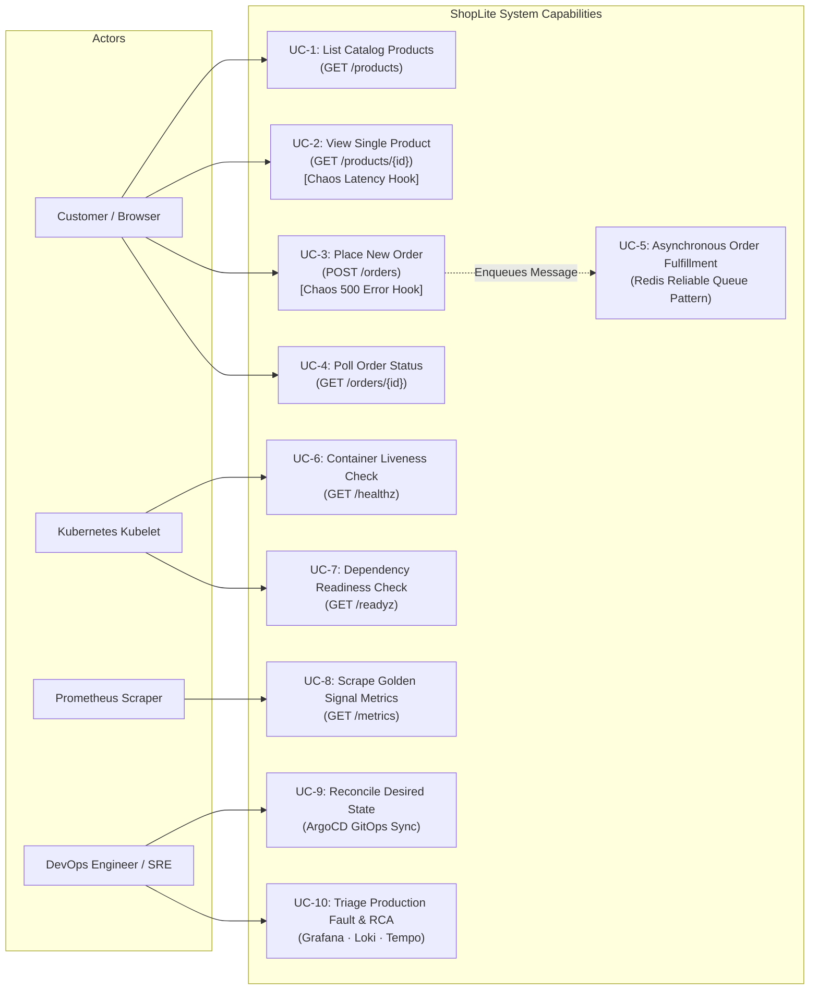
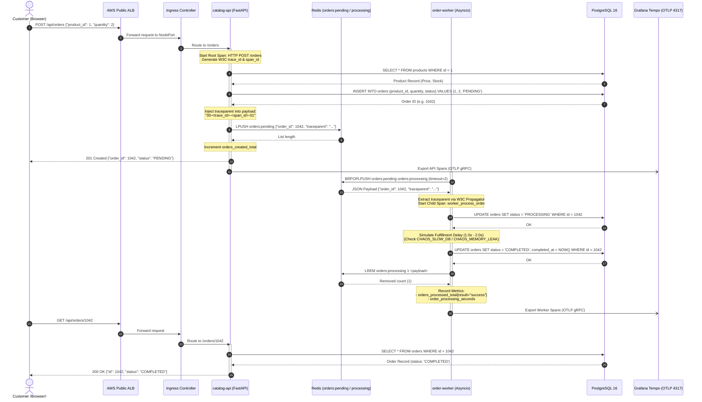

# Use Case & Distributed Sequence Diagrams

This document illustrates the end-to-end operational use cases and the distributed trace execution sequence across the ShopLite platform.

---

## 1. System Use Case Diagram

---

## 2. Distributed Order Lifecycle & Trace Sequence Diagram

This sequence diagram illustrates the complete W3C `traceparent` context propagation across `catalog-api`, `redis`, `order-worker`, `postgres`, and `tempo`:

