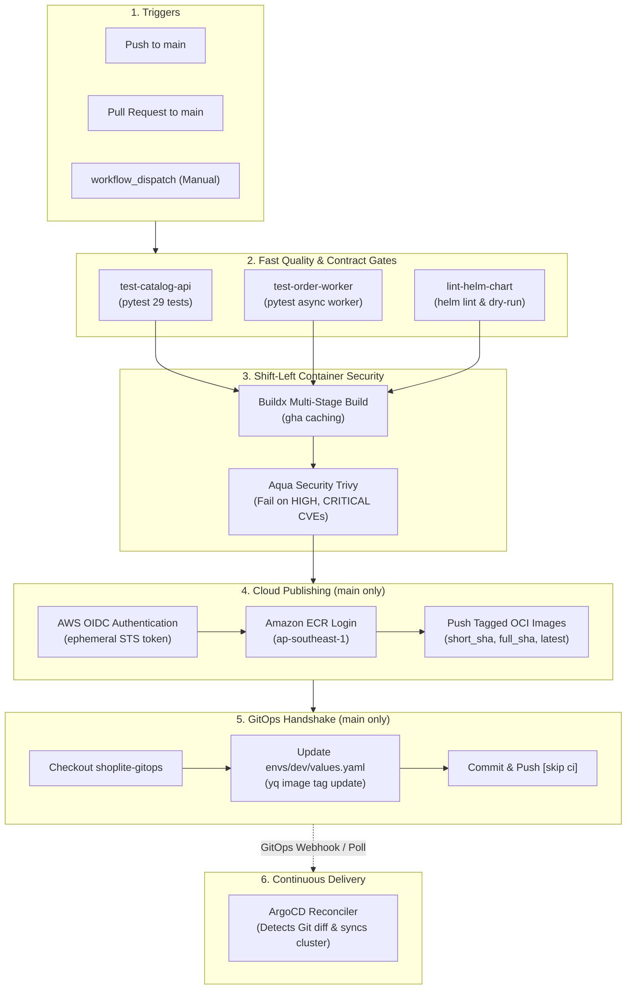

# Phase 3C Sub-Phase 5: CI/CD Pipeline Architecture Synthesis

## 1. Executive Summary & Delivery Scope

Phase 3C establishes the continuous integration and automated GitOps promotion pipeline for the ShopLite cloud-native microservices platform. Operating strictly under **The Golden Rule (Constraint C2)** of `AGENTS.md`, the pipeline provides automated validation, container vulnerability screening, secure cloud artifact publishing, and cross-repository GitOps delivery without ever granting cluster deployment privileges to CI runners.

---

## 2. CI/CD Architecture & Pipeline Topology

The complete workflow is defined declaratively in [.github/workflows/ci.yaml](file:///.github/workflows/ci.yaml) and consists of four sequential, interdependent phases:

---

## 3. Detailed Stage Specifications

### Stage 1: Quality & Contract Verification
- **`test-catalog-api`:** Executes unit tests with SQLite in-memory driver. Validates HTTP response codes (`200`, `201`, `404`, `500`), chaos error injection, and Prometheus exposition.
- **`test-order-worker`:** Validates Redis reliable queue consumer loops, atomic state transitions (`orders:pending` $\to$ `orders:processing` $\to$ `COMPLETED`), and OpenMetrics exemplar attachment.
- **`lint-helm-chart`:** Validates Helm syntax via `helm lint` and verifies dry-run template rendering against both `values-dev.yaml` and `values-prod.yaml`.

### Stage 2: Shift-Left Security & CVE Scanning
- **Matrix Build:** Concurrently builds all 3 microservices (`catalog-api`, `order-worker`, `web`) using Docker Buildx and GitHub Actions layer caching.
- **Trivy Vulnerability Scanner:** Inspects both base OS packages and application dependencies. Enforces `exit-code: 1` on any unpatched `CRITICAL` or `HIGH` vulnerabilities (`ignore-unfixed: true`).

### Stage 3: AWS OIDC Federated Authentication & ECR Publishing
- **Zero-Static Credentials:** Connects to AWS STS via OpenID Connect (`aws-actions/configure-aws-credentials@v4`) assuming IAM Role `arn:aws:iam::263303066497:role/shoplite-github-actions-role`.
- **Multi-Tag Publishing:** Publishes immutable OCI artifacts to `shoplite-catalog-api`, `shoplite-order-worker`, and `shoplite-web` in `ap-southeast-1` tagged with short Git commit SHA, full Git SHA, and `latest`.

### Stage 4: Cross-Repository GitOps Handshake
- **Target Repository:** `DevMahbubHussain/shoplite-gitops` (`main` branch).
- **Automated Manifest Patching:** Updates `envs/dev/values.yaml` image tags with the short commit SHA.
- **Safe Commits:** Commits with `[skip ci]` and verifies `git diff --staged --quiet` to ensure idempotent pipeline runs without recursive CI loops.

---

## 4. Constraint Adherence Verification Matrix

| Constraint | Description | Verification Method | Status |
| :--- | :--- | :--- | :--- |
| **C1** | No Guessed Code | Verified against official GitHub Actions, Trivy, and AWS docs | Verified |
| **C2** | Strict Separation of CI vs GitOps | CI contains zero `kubectl` or `helm upgrade` commands | Enforced |
| **C3** | Zero AI Attributions | Code, commits, and workflows contain no AI or LLM references | Enforced |
| **C5** | Security & Least Privilege | AWS OIDC authentication, zero plain-text secrets in repository | Enforced |
| **C8** | Conventional Commits & Branching | Parent-child branch isolation preserved with `--no-ff` merges | Enforced |
| **C21**| Zero Branch Deletion Policy | All child feature branches preserved permanently in remote Git | Enforced |
